# OpenDomus

Your home, wired together. Open, self-hosted home automation in Go and TypeScript.

OpenDomus polls your devices, stores every reading in PostgreSQL (TimescaleDB) and
gives you a wall dashboard, a back office to manage it all, and a visual automation
editor. No cloud account needed: everything runs on a machine in your house.

## Screenshots

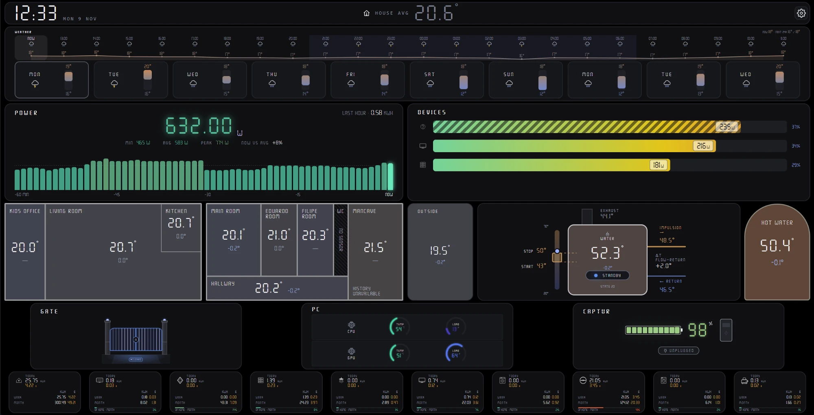

*The wall dashboard (`frontend/`). Its sections:*

**Weather forecast** (IPMA): hourly for the next 24 h and the next ten days.

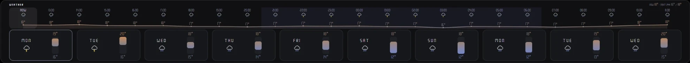

**Live power**: current draw, min/avg/peak, last hour as a bar chart.

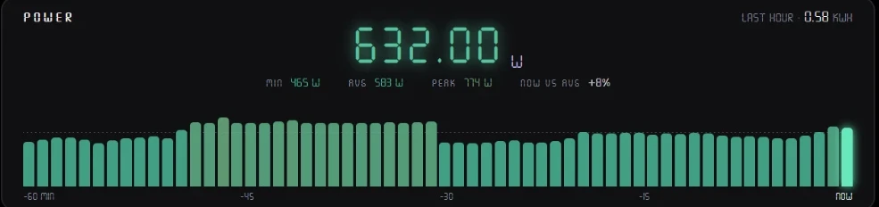

**Per-device breakdown**: what is drawing power right now, as a share of the total.

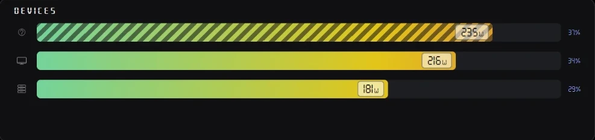

Clicking a device opens its history chart with the min, average and max power per interval.

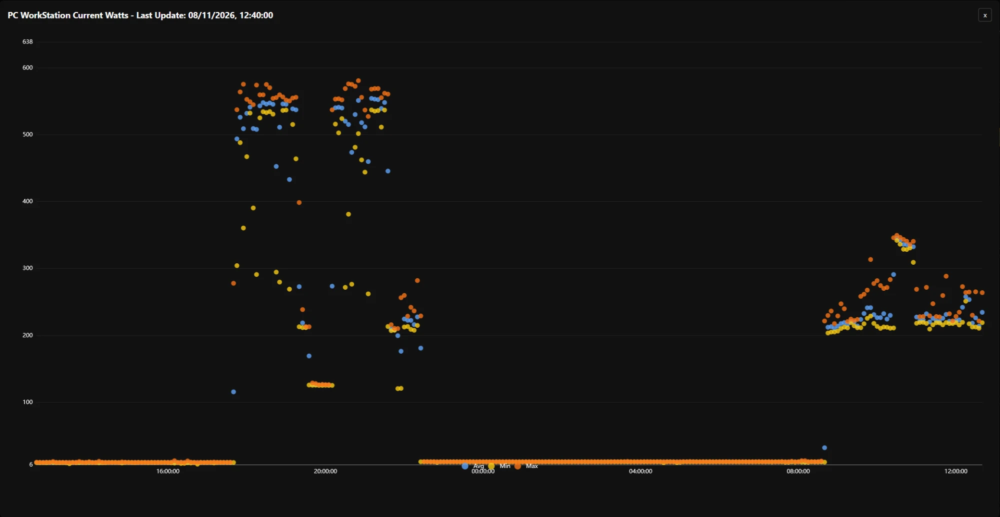

**Room temperatures** on the floor plans, with the change over the last hour, plus outside.

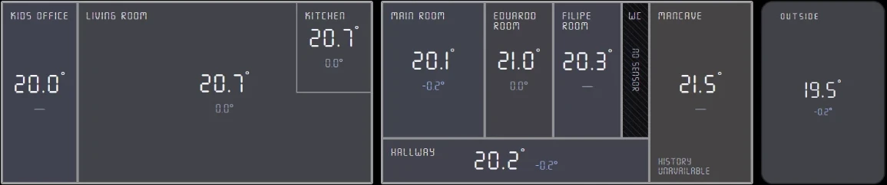

Clicking a room opens its temperature over the last 24 hours.

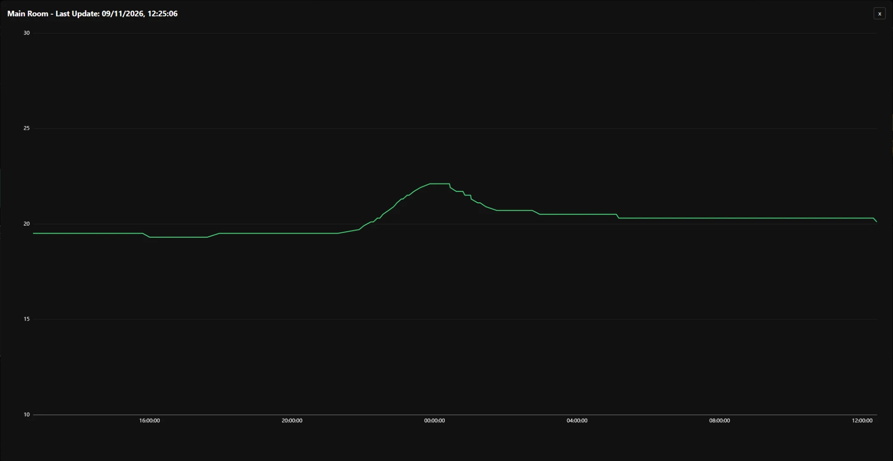

**Heat pump and hot water**: water temperature, stop/start setpoints, flow and return, state.

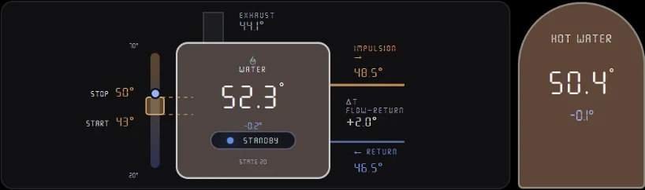

**Gate, PC and car status**: gate open/closed, CPU and GPU temperature and load, EV battery.

 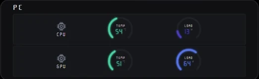 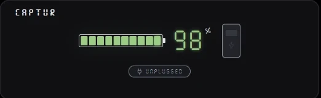

**Energy per device**: kWh and cost today, this week and this month, and the share of the house total.

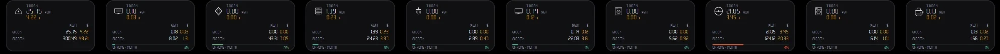

Clicking a device shows its kWh and cost for today, yesterday, this and last week, this and last month.

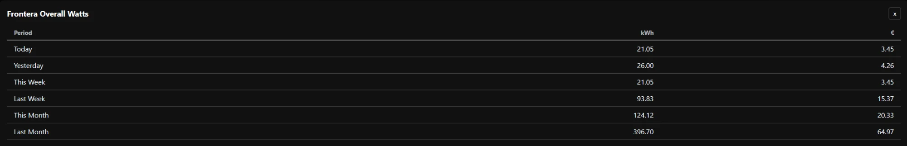

## Features

- **Devices** – Shelly (1, EM, Plug S, Plus/Gen3 Plug S, Plug M Gen3), NOUS A1T,
  SNZB-02D (via MQTT), EcoForest heat pump, Rohan Air (Tuya), Renault cars (MyRenault),
  Yeelight. Add your own by implementing one Go type in `backend/internal/devices/`.
- **Tags** – every reading (temperature, power, boolean, GPS location) is a tag value
  with history. Phones and sensors can push values through a simple API-key URL.
- **Automations** – a node graph: triggers (cron timer, sunrise/sunset, tag value
  thresholds), gates (and, or, condition, delayed check) and actions (turn a device
  on/off, HTTP call, WhatsApp message).
- **Dashboard** (`frontend/`) – temperatures per room on floor plans, power now and per
  device, daily energy and cost, weather (IPMA), gate, car and PC status.
- **Back office** (`backoffice/`) – manage devices, tags and users, browse tag history,
  read the logs, and edit automations in a drag-and-drop flow editor.
- **MCP server** – `/mcp` exposes devices and tag history to AI assistants
  (`list_devices`, `list_tags`, `get_tag_latest_value`, `get_tag_history`, ...).
- **Alerts** – WhatsApp notifications through callmebot.

## Layout

```
backend/      Go REST API, device polling, automations, MCP server   (port 4000)
frontend/     Vue 3 + Vite wall dashboard
backoffice/   Vue 3 + Quasar admin app
Dockerfile.go Single image: backend + both web apps behind nginx
docker-compose.yml  App + TimescaleDB
```

## Run with Docker

```sh
cp .env.example .env            # fill in DB_*, JWT_SECRET, ADMIN_PASSWORD at least
cd frontend && npm install && npm run build && cd ..
cd backoffice && npm install && npm run build && cd ..
docker build -f Dockerfile.go -t opendomus-app:latest .
docker compose up -d
```

Then open:

- Dashboard: http://localhost:8082/frontend/
- Back office: http://localhost:8082/bo/ (log in as `admin` with `ADMIN_PASSWORD`)
- API: http://localhost:4000/


## Run for development

Each part has its own README with details. In short, with PostgreSQL running:

```sh
cp .env.example backend/.env && cd backend && go run ./cmd/od   # API on :4000
cd frontend   && npm install && npm run dev                   # dashboard on :3007
cd backoffice && npm install && npm run dev                   # back office, opens the browser
```

Point the web apps at the API with `frontend/public/config.js` and
`backoffice/public/config.json` (copy from `config.example.json`).

## Configuration

All settings are environment variables, documented in [`.env.example`](.env.example).
Required: `JWT_SECRET`, `DB_HOST`, `DB_NAME`, `DB_USER`. Set `LATITUDE` and `LONGITUDE`
for sunrise/sunset automations.

## License

Apache 2.0, see [LICENSE](LICENSE) and [NOTICE](NOTICE).

© 2026 Infinite Pi Studios · JBP <joaobper@gmail.com>
